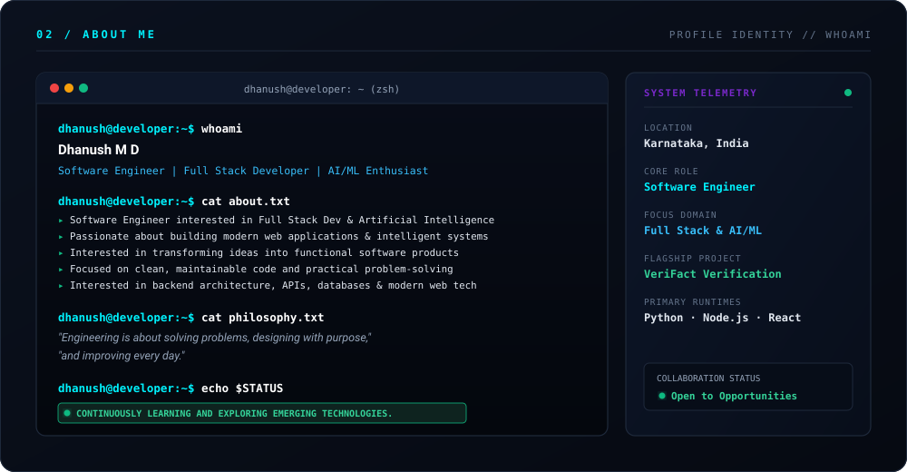
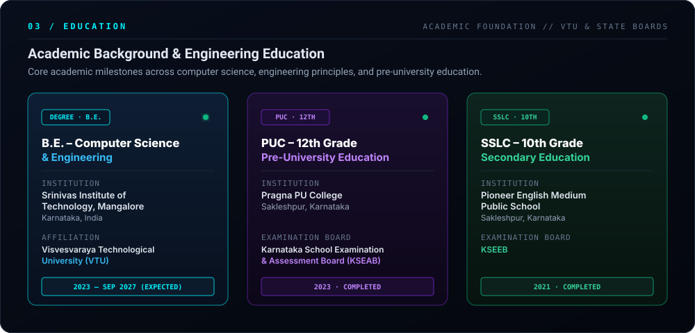
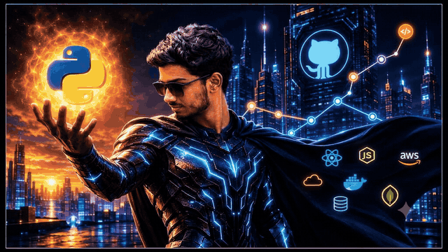
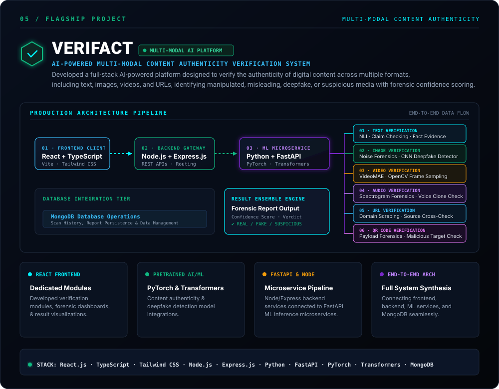
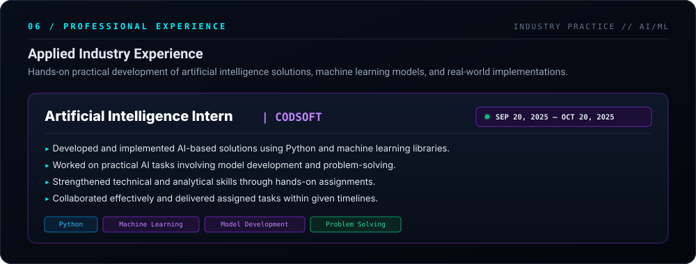
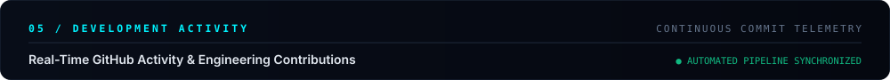
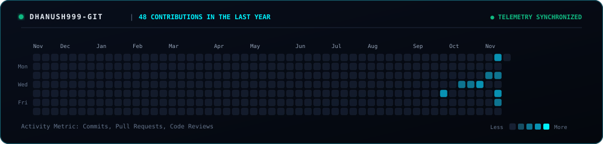
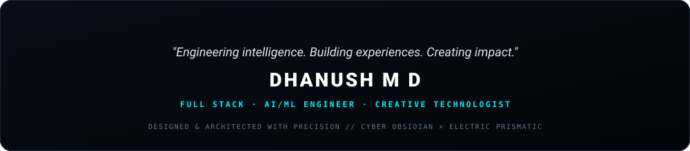

<!-- ═══════════════════════════════════════════════════════════════════
     DHANUSH M D — PREMIUM GITHUB PROFILE ARCHITECTURE
     Cyber Obsidian × Electric Prismatic Palette
     ═══════════════════════════════════════════════════════════════════ -->

<!-- ═══ SECTION 01: PROFILE IDENTITY ═══ -->

 

<!-- ═══ HERO SOCIAL BADGES STRIP ═══ -->

  
  &nbsp;&nbsp;
  
  &nbsp;&nbsp;
  
  &nbsp;&nbsp;
  

<!-- ═══ DYNAMIC TYPING TELEMETRY ANIMATION ═══ -->

  

 

<!-- ═══ SECTION 02: ABOUT ME (DEVELOPER TERMINAL) ═══ -->

  

 

<!-- ═══ SECTION 03: EDUCATION (ACADEMIC BACKGROUND) ═══ -->

  

 

<!-- ═══ SECTION 04: TECHNICAL SKILLS ═══ -->

  

 

<b style="color: #00F2FE; cursor: pointer;">Explore Detailed Technical Stack &amp; Architectural Context (Expand Table)</b>

 

| Layer / Domain | Core Technologies &amp; Frameworks | Architectural Context &amp; Implementation |
|---|---|---|
| **01 Programming Languages** | Python, Java, C, JavaScript, TypeScript | Algorithmic pipelines, type-safe full-stack development, asynchronous backends &amp; relational data queries |
| **02 Frontend Development** | HTML5, CSS3, React.js, Next.js, Tailwind CSS | Responsive user interfaces, reusable components, interactive dashboards &amp; high-performance client rendering |
| **03 Backend Development** | Node.js, Express.js, FastAPI, Flask, REST API Development | RESTful APIs, asynchronous microservices, request routing &amp; service orchestration |
| **04 Databases** | MySQL, MongoDB, PostgreSQL, Supabase | Relational schemas, document storage, queries, views, indexing &amp; backend data persistence |
| **05 Developer Tools &amp; Platforms** | Git, GitHub, Visual Studio Code, Antigravity | Version control workflows, collaborative software engineering &amp; modern development environments |
| **06 Creative Tools** | Adobe After Effects, Adobe Premiere Pro | Motion graphics, visual asset production, sequence assembly &amp; high-fidelity media workflows |

 

<!-- ═══ LOOPING VISUAL ═══ -->

  

 

<!-- ═══ SECTION 05: PROJECTS — VERIFACT ═══ -->

  

 

<!-- ═══ SECTION 06: PROFESSIONAL EXPERIENCE ═══ -->

  

 

<!-- ═══ SECTION 07: CERTIFICATIONS & CREDENTIALS ═══ -->

  

 

<b style="color: #10B981; cursor: pointer;">View Additional Certifications &amp; Credentials (Expand Table)</b>

 

| Organization / Platform | Certification &amp; Credential | Year &amp; Details |
|---|---|---|
| **Infosys Springboard** | Cloud, Livelihood | 2026 · Grade A+ |
| **Infosys Springboard** | Software Engineering and Agile | 2025 |
| **NoSQL Systems** | NoSQL MongoDB | Document schema design, aggregation pipelines &amp; indexing |
| **Distributed Systems** | Blockchain Virtual Internship | Decentralized protocols, consensus algorithms &amp; smart contracts |
| **Security &amp; Networks** | Networking for Cyber Professionals | OSI layer routing, packet flow inspection &amp; perimeter defense |
| **Cyber Defense** | Fundamentals of Cybersecurity | Threat modeling, vulnerability analysis &amp; security hygiene |

 

<!-- ═══ SECTION 08: GITHUB STATISTICS & ACTIVITY ═══ -->

  

 

  

 

<!-- ═══ GITHUB STATS & STREAK ═══ -->

  
  &nbsp;&nbsp;
  

  

 

<!-- ═══ SECTION 09: SOCIAL CONNECTIONS ═══ -->

  

 

  
  &nbsp;&nbsp;
  
  &nbsp;&nbsp;
  
  &nbsp;&nbsp;
  

  
  &nbsp;&nbsp;
  
  &nbsp;&nbsp;
  
  &nbsp;&nbsp;
  

 

<!-- ═══ SECTION 10: ENGINEERING PHILOSOPHY (THREE PILLARS) ═══ -->

  

 

<!-- ═══ SIGNATURE FOOTER ═══ -->

  

