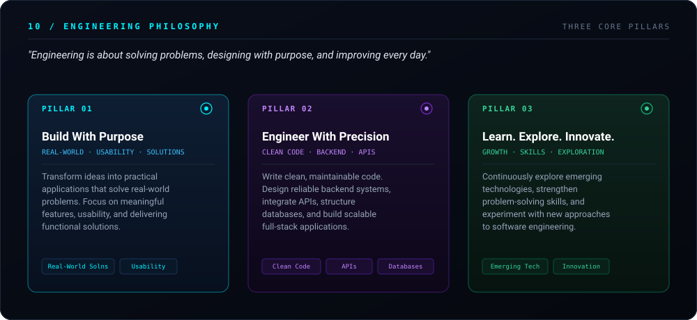
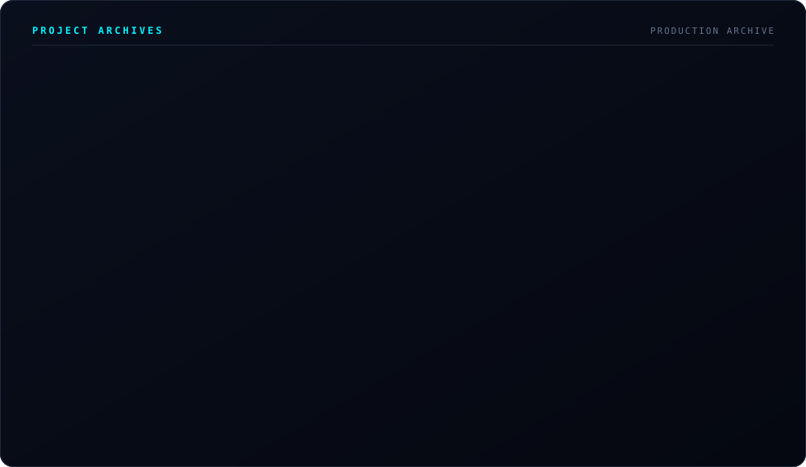
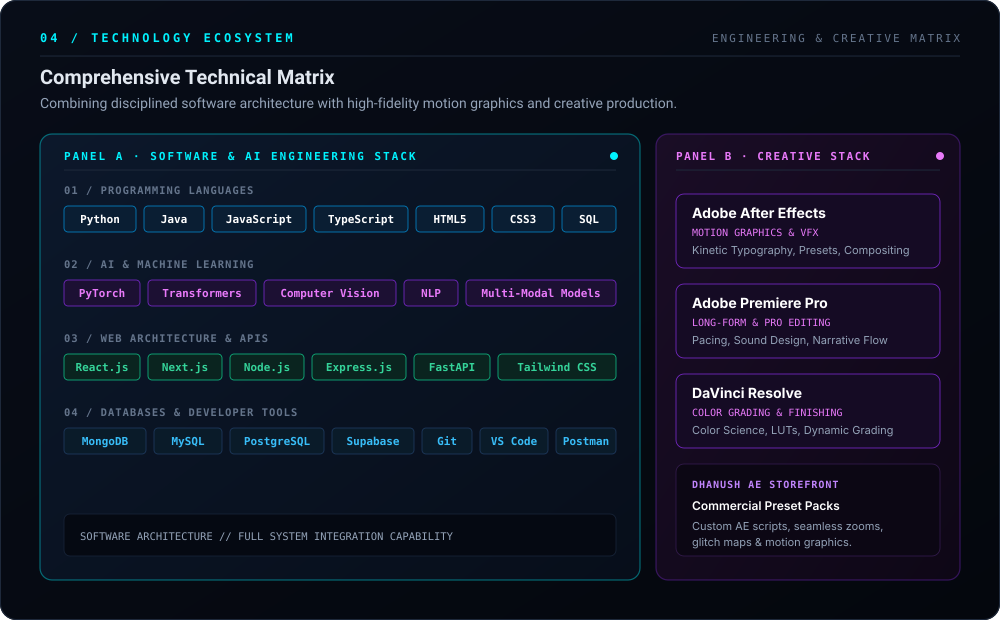
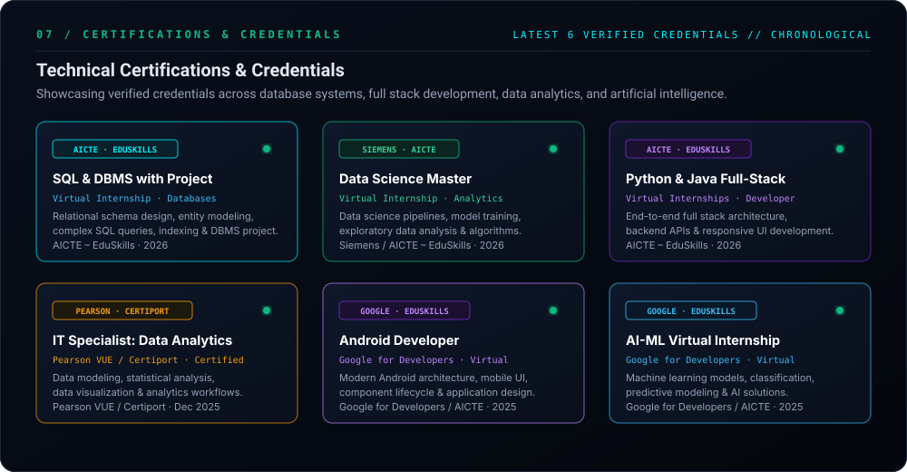
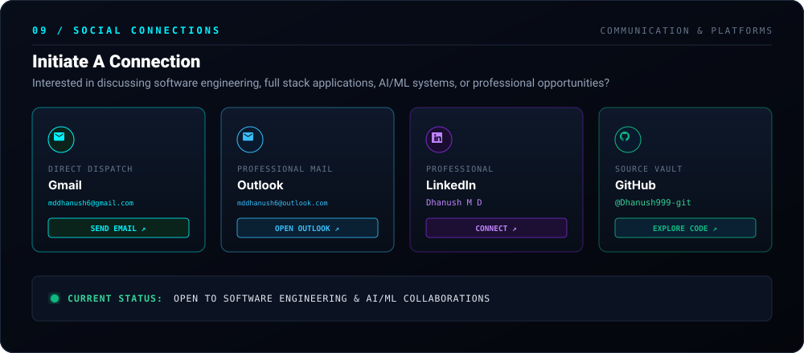

<!-- ═══════════════════════════════════════════════════════════════════
     DHANUSH M D — PREMIUM GITHUB PROFILE ARCHITECTURE
     Cyber Obsidian × Electric Prismatic Palette
     ═══════════════════════════════════════════════════════════════════ -->

<!-- ═══ SECTION 01: CINEMATIC HERO ═══ -->

 

<!-- ═══ HERO SOCIAL BADGES STRIP ═══ -->

  
  &nbsp;&nbsp;
  
  &nbsp;&nbsp;
  
  &nbsp;&nbsp;
  
  &nbsp;&nbsp;
  

<!-- ═══ DYNAMIC TYPING TELEMETRY ANIMATION ═══ -->

  

 

<!-- ═══ SECTION 02: ABOUT ME (DEVELOPER TERMINAL) ═══ -->

  

 

<!-- ═══ SECTION 03: ENGINEERING PHILOSOPHY (THREE PILLARS) ═══ -->

  

 

<!-- ═══ SECTION 04: FLAGSHIP SYSTEM – VERIFACT ═══ -->

  

 

<!-- ═══ SECTION 05: OTHER SELECTED PROJECTS ═══ -->

  

 

<!-- ═══ SECTION 06: TECHNOLOGY ECOSYSTEM ═══ -->

  

 

<b style="color: #00F2FE; cursor: pointer;">Explore Detailed Technical Stack &amp; Architectural Context (Expand Table)</b>

 

| Layer / Domain | Core Technologies &amp; Frameworks | Architectural Context &amp; Implementation |
|---|---|---|
| **01 Programming Languages** | **Python (Primary)**, TypeScript, JavaScript, Java, HTML5, CSS3, SQL | Algorithmic pipelines, type-safe full stack development, asynchronous backends &amp; relational data queries |
| **02 AI &amp; Machine Learning** | PyTorch, Transformers, VideoMAE, OpenCV, NLP, Computer Vision, NLI | Deepfake detection, temporal video classification, fact-checking NLI pipelines, and image artifact forensics |
| **03 Frontend Development** | React.js, Next.js, Tailwind CSS, Vite, Framer Motion, HTML5, CSS3 | Glassmorphic design systems, forensic dashboards, micro-interactions, and high-performance client rendering |
| **04 Backend &amp; Microservices** | Node.js, Express 5, FastAPI, REST APIs, Uvicorn, JWT Authentication | API gateway orchestration, high-throughput asynchronous inference microservices, and secure session management |
| **05 Databases &amp; Auth** | MongoDB, PostgreSQL, MySQL, Supabase, Prisma ORM | Document storage for scan history, relational schemas for transactions, and Supabase auth integrations |
| **06 Development &amp; DevOps** | Git, GitHub Actions, VS Code, Postman, Linux, CI/CD Workflows | Continuous integration, automated SVG contribution telemetry, code review discipline, and API verification |
| **07 Creative Suite &amp; Motion** | Adobe After Effects, Adobe Premiere Pro, DaVinci Resolve | Motion graphics, custom video presets, cinematic editing, dynamic transitions, and commercial storefront assets |

 

<!-- ═══ SECTION 07: DEVELOPMENT ACTIVITY & COMMIT LOG ═══ -->

  

 

  

 

<!-- ═══ GITHUB STATS & STREAK ═══ -->

  
  &nbsp;&nbsp;
  

  

 

<!-- ═══ SECTION 08: CERTIFICATIONS & PROFESSIONAL DEVELOPMENT ═══ -->

  

 

<b style="color: #10B981; cursor: pointer;">View Verified Credential List &amp; Competency Focus (Expand Table)</b>

 

| Domain Focus | Credential / Specialization | Core Competencies &amp; Applied Work |
|---|---|---|
| **Database Architecture** | SQL &amp; DBMS with Project | Relational schema design, entity modeling, complex SQL queries, views &amp; indexing |
| **Artificial Intelligence** | AI Internship – CODSOFT | Deep learning workflows, NLP conversational bots, classification &amp; recommendation models |
| **Full Stack Engineering** | Python Full Stack Internship | End-to-end web architecture, API gateway routing, frontend state management &amp; deployment |
| **NoSQL Systems** | NoSQL MongoDB | Document schema design, aggregation pipelines, performance indexing &amp; high-throughput queries |
| **Distributed Systems** | Blockchain Virtual Internship | Decentralized protocols, consensus algorithms, cryptographic verification &amp; distributed ledgers |
| **Security &amp; Networks** | Networking for Cyber Professionals | OSI layer routing, packet flow inspection, perimeter defense &amp; network security protocols |
| **Cyber Defense** | Fundamentals of Cybersecurity | Threat modeling, vulnerability analysis, encryption standards &amp; defensive security hygiene |

 

<!-- ═══ SECTION 09: CONNECTIVITY HUB ═══ -->

  

 

  
  &nbsp;&nbsp;
  
  &nbsp;&nbsp;
  
  &nbsp;&nbsp;
  

 

<!-- ═══ SECTION 10: SIGNATURE FOOTER ═══ -->

  

